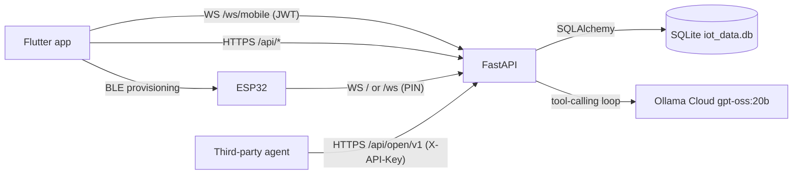

# Architecture overview

Maya is a family smart-home system: a Flutter app and an AI assistant that
switch relay channels on ESP32-based smart power extensions, plus parental
features (children, homework, screen time, location) layered on the same house.

Three deployables plus one integration surface:

| Component | Path | Language | Indexed? |
|---|---|---|---|
| FastAPI backend | `software/server` | Python (6 files, 179 symbols) | yes, tier `scope` |
| Flutter mobile app | `software/mobile/lib` | Dart (20 files, 558 symbols) | yes, tier **`name`** |
| ESP32 firmware | `hardware/smartextension` | Arduino C++ (618 lines) | **no** — see [known-gaps §5](known-gaps.md#5-esp32-firmware-is-not-indexed-at-all) |
| Open API skill | `software/skills/maya-open-api` | Markdown (agent skill) | n/a |

## Runtime topology

The server is the hub. Nothing talks device-to-phone directly except BLE
provisioning.



## The four entry surfaces

The server has four distinct authentication surfaces. Confusing them is the
easiest way to introduce a hole, so they are listed together:

| Surface | Route(s) | Auth | Guard symbol |
|---|---|---|---|
| Mobile/web API | `/api/*` (~60 routes) | JWT bearer | `get_current_user`, `get_current_user_or_child` |
| Mobile realtime | `WS /ws/mobile` | JWT in first frame | inline decode, `main.py:2303` |
| Device realtime | `WS /ws`, `WS /` | device PIN in message | `_handle_websocket` |
| Open API v1 | `/api/open/v1/*` | `X-API-Key` header | `get_api_key_house` |

Detail per component: [server backend](server-backend.md) ·
[mobile app](mobile-app.md) · [firmware](firmware-esp32.md) ·
[Maya AI agent](maya-ai-agent.md) · [data model](data-model.md).

## Module dependency graph (server)

From `code2graph module-deps` in `software/server`, `import`-kind edges only.
Counts are distinct imported names:

```
main.py ──17──> models.py
main.py ──9───> auth.py
main.py ──4───> database.py
main.py ──?───> ai.py        ⚠ real (main.py:26) but ABSENT from the graph
auth.py ──4───> models.py
auth.py ──1───> database.py
models.py ─1──> database.py
```

The `ai.py` edge is missing because `import ai` is a bare module import —
see [known-gaps §2](known-gaps.md#2-bare-import-ai-is-invisible--aipy-is-an-orphan-in-the-graph).
The shape is otherwise a clean layering: `database` at the bottom, `models` on
it, `auth` on both, `main` on everything.

There is no equivalent graph for Dart — `module-deps` returns nothing for the
mobile root at either tier ([known-gaps §3](known-gaps.md#3-dart-resolves-only-at---tier-name-module-deps-never-works-for-dart)).

## Cross-cutting flows worth knowing

**Command path.** App calls `POST /api/devices/{id}/command` → server resolves
permissions → `_dispatch_command` pushes over the device's WebSocket → firmware
validates PIN, drives the GPIO, ACKs with all channel states → server persists
and broadcasts to the house.

**Maya path.** A chat message mentioning `@maya` (or `POST /api/maya/voice`)
starts the tool-calling loop in `run_maya_agent` (`main.py:1570`). Both entry
points share that one function — verified: `code2graph usages run_maya_agent`
returns exactly two call sites, `_run_maya()` (`main.py:1601`) and `maya_voice()`
(`main.py:1704`). See [Maya AI agent](maya-ai-agent.md).

**Automation path.** `POST /api/screen-time/report` from a child device can trip
`_notify_screen_limit`, which posts a Maya chat message, `@`-mentions the parents
and the child, logs it and broadcasts — all best-effort so a failed alert cannot
break the report.
